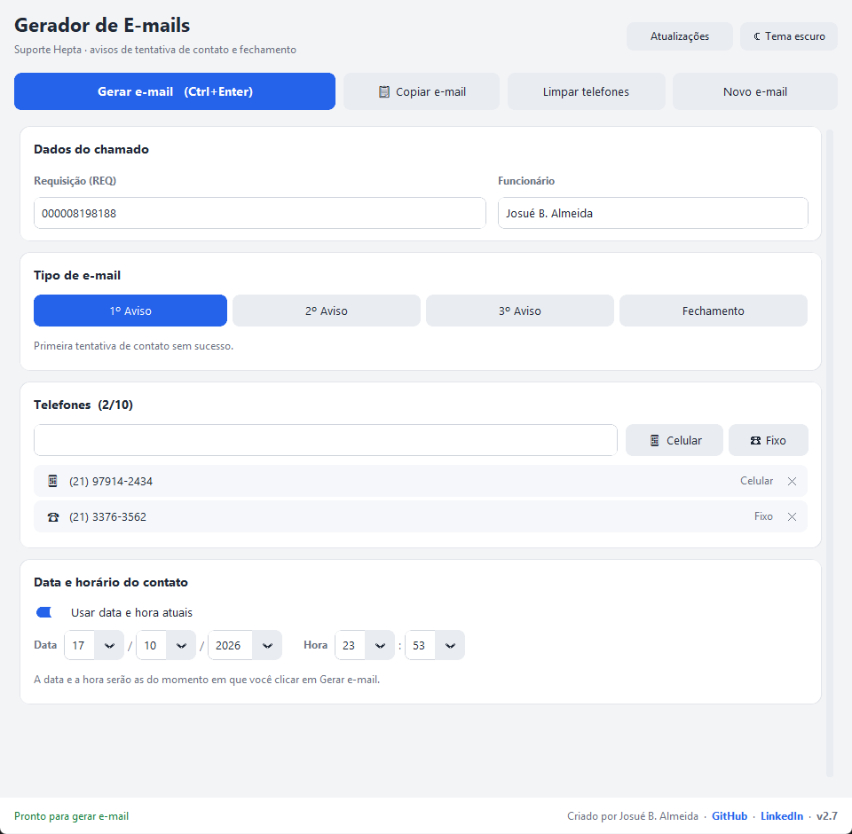
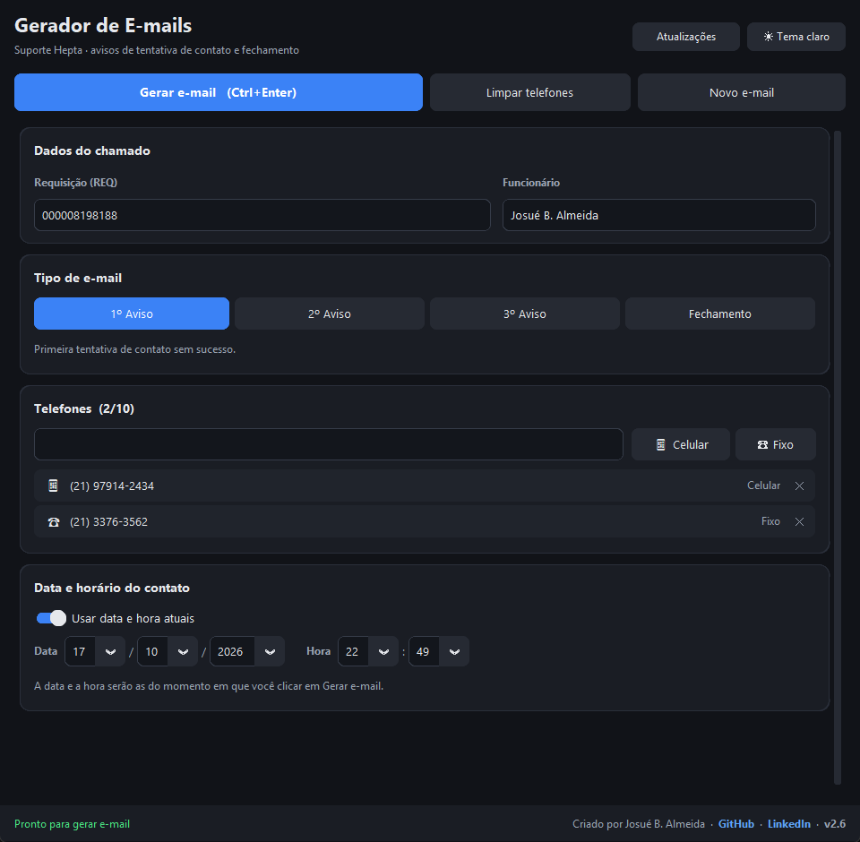
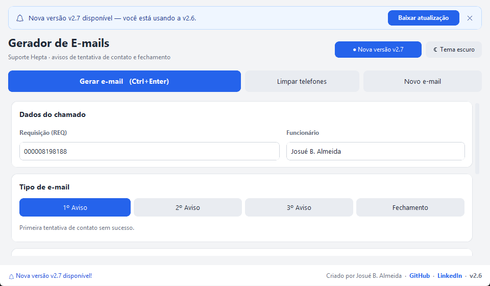

# Gerador de E-mails — Suporte Hepta

Ferramenta desktop para Windows que gera, em segundos, os e-mails padronizados de tentativa de contato (1º, 2º e 3º aviso) e de fechamento de chamado improdutivo.

| Tema claro | Tema escuro |
| :---: | :---: |
|  |  |

## Download

1. Baixe o `GeradorEmailHepta.exe` na [página da última versão](https://github.com/Joshpcbrrj/gerador-email-hepta/releases/latest).
2. Dê dois cliques para abrir. Não precisa instalar nem ter Python.

> **O Windows mostrou "O Windows protegeu o computador"?** Isso acontece porque o executável não é assinado digitalmente. Clique em **Mais informações** → **Executar assim mesmo**.

## Como usar

1. **REQ** — digite o número da requisição (ex: `000008198188`). Confira o **Funcionário**: o programa lembra o último nome usado.
2. **Tipo de e-mail** — escolha 1º, 2º ou 3º aviso, ou **Fechamento**. A descrição abaixo dos botões explica cada um.
3. **Telefones** — digite o número com DDD e clique em **Celular** ou **Fixo** (Enter adiciona como celular). Use o **✕** da linha para remover. Limite de 10 por chamado; no Fechamento são opcionais.
4. **Data e horário** — com **Usar data e hora atuais** ligado (padrão), o e-mail registra o horário do momento em que você clica em gerar, mesmo que o programa esteja aberto há horas. Para informar outro horário, escolha nos campos: a opção desliga sozinha.
5. **Gerar e-mail** (ou **Ctrl+Enter**) — o e-mail abre no navegador. O Fechamento abre também a nota de chamado improdutivo.

Para levar ao Outlook/Gmail: no navegador, **Ctrl+A** → **Ctrl+C**, e no e-mail **Ctrl+V**.

**Novo e-mail** limpa o formulário e volta o horário para o atual. **Limpar telefones** limpa só a lista.

## Atualizações

O programa verifica se há versão nova ao abrir e a cada 4 horas. Quando há, aparece uma faixa no topo da janela:

Clique em **Baixar atualização**, baixe o novo `.exe` e substitua o antigo. O **✕** esconde a faixa, mas o botão **Atualizações** continua destacado. Esse botão também faz a verificação na hora.

## O que o programa gera

**Aviso (1º, 2º e 3º)** — título com a REQ e o número da tentativa, telefones e data/hora do contato, instruções para autorizar o acesso remoto com imagem do WinVNC e assinatura com o logo da Hepta.

**Fechamento** — título `REQ… - Chamado Fechado`, informação sobre as 3 tentativas sem sucesso, aviso sobre reabertura indevida e agradecimento. Abre junto a **Nota de Chamado Improdutivo**, pronta para copiar no chamado.

## Problemas comuns

| Situação | O que fazer |
| --- | --- |
| Aviso do SmartScreen ao abrir | **Mais informações** → **Executar assim mesmo** (veja [Download](#download)). |
| "Não foi possível verificar atualizações" | O computador não acessou o GitHub (sem internet ou bloqueio da rede/proxy). O programa funciona normalmente; baixe a versão nova direto na [página de releases](https://github.com/Joshpcbrrj/gerador-email-hepta/releases/latest). |
| Horário diferente do esperado no e-mail | Confira se **Usar data e hora atuais** está ligado e se o relógio do Windows está certo. |
| E-mail não abre | O programa usa o navegador padrão do Windows. Confira em *Configurações → Aplicativos → Aplicativos padrão*. |
| Mensagem de "erro inesperado" | O programa continua aberto. Os detalhes ficam no arquivo de log (veja [Privacidade e arquivos](#privacidade-e-arquivos)); anexe-o ao [abrir uma issue](https://github.com/Joshpcbrrj/gerador-email-hepta/issues). |

## Privacidade e arquivos

- Os e-mails gerados ficam em `%TEMP%\gerador_email_hepta` e são **apagados ao fechar** o programa.
- O tema e o nome do funcionário ficam em `%APPDATA%\GeradorEmailHepta\preferencias.json`.
- Erros são registrados em `%APPDATA%\GeradorEmailHepta\gerador.log` (sem dados de clientes). Se for relatar um problema, anexe esse arquivo.
- O único acesso à internet é a consulta da última versão na API pública do GitHub (`api.github.com`). Nenhum dado de chamado ou de cliente é enviado.

## Mais informações

- [Histórico de versões (CHANGELOG)](CHANGELOG.md)
- [Guia de desenvolvimento](docs/DESENVOLVIMENTO.md) — rodar pelo código, testes, gerar o `.exe` e publicar uma versão
- Encontrou um problema ou tem uma sugestão? [Abra uma issue](https://github.com/Joshpcbrrj/gerador-email-hepta/issues)

## Autor

Desenvolvido por **Josué B. Almeida** — [GitHub](https://github.com/Joshpcbrrj) · [LinkedIn](https://www.linkedin.com/in/josualmeida/) · [joshpcbrrj@gmail.com](mailto:joshpcbrrj@gmail.com)

Agradecimentos aos colegas que testaram e ajudaram a refinar os modelos de e-mail, à comunidade Python e ao DeepSeek, parceiro na jornada de *vibe coding* que deu origem à interface.

## Licença

[MIT](LICENSE)
